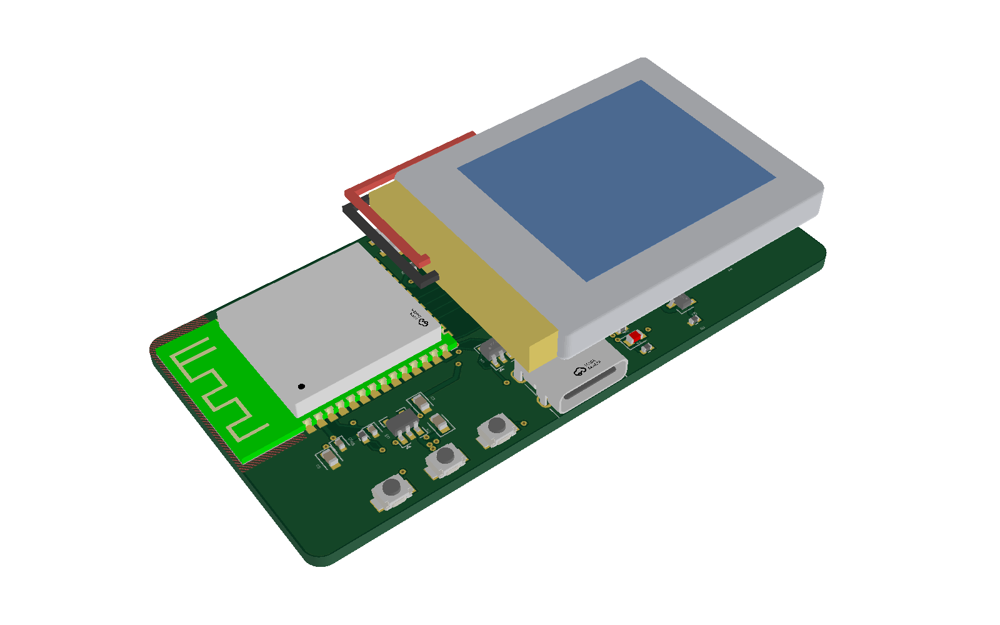
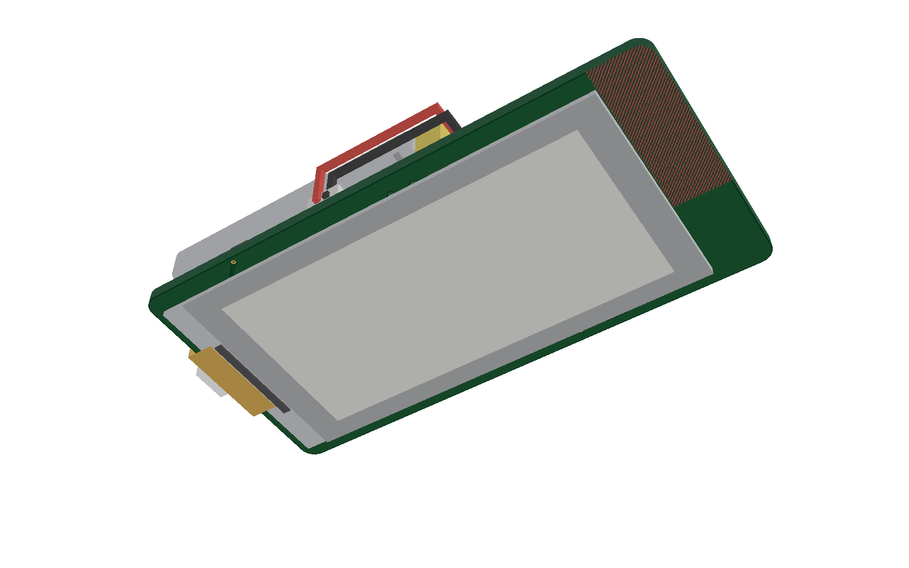
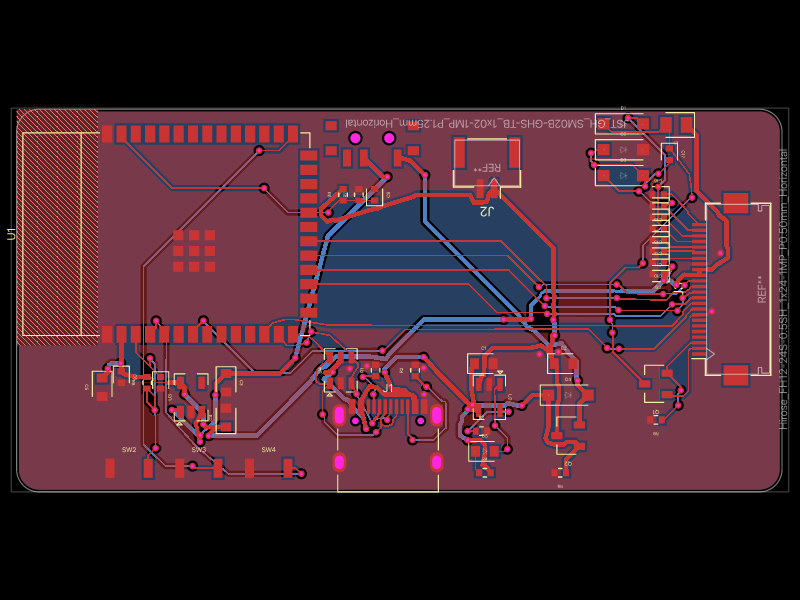

<div align="center">



<br />

# TuneWear

### Your now-playing, clipped to your jacket.

A wearable e-paper badge that shows the song you're listening to, pulled live from Last.fm.<br />
**Custom 68 × 34 mm PCB, designed entirely as code. ESP32-S3, USB-C charging, and an e-paper screen that keeps its image with zero power.**

<br />

[](#-hardware)
[](hardware)
[](firmware)
[](#-how-it-works)
[](#-pcb)

[**Both sides**](#-both-sides) · [**Hardware**](#-hardware) · [**PCB**](#-pcb) · [**Build it**](#%EF%B8%8F-build-it) · [**How it works**](#-how-it-works)

</div>

<br />

## 👀 Both sides

<table>
<tr>
<td width="50%" valign="top" align="center">



<sub><b>Front.</b> The 2.13" e-paper sits flat on the bare underside of the board. Its ribbon cable wraps around the edge into the connector on the other side.</sub>

</td>
<td width="50%" valign="top" align="center">


<sub><b>Back (bare board).</b> All parts are on this side: the ESP32-S3 with its antenna clear of copper, USB-C, three buttons, the charger and the display connector. The battery sits on top of them.</sub>

</td>
</tr>
</table>

<br />

## 🎵 What it does

|  | |
|---|---|
| 🎧 **Now playing** | Polls your Last.fm profile and shows the current track title and artist. A splash screen appears when nothing is playing. |
| 🧹 **Clean titles** | Strips "(feat. …)" so the title fits, and drops to a smaller font for long names. |
| 📱 **Phone switch** | A Blynk app button puts it to sleep or wakes it, and the app mirrors the current song. |
| 📶 **Roams** | Remembers several Wi-Fi networks (home, phone hotspot) and joins whichever is in range. |
| 🔋 **Runs on a LiPo** | Charges over USB-C, runs from USB while charging, has a hard power switch. E-paper keeps the last image with zero power. |

<br />

## 🧰 Hardware

<table>
<tr>
<td width="50%" valign="top">

### 🧠 Brains and display
- **ESP32-S3-WROOM-1-N8**: Wi-Fi + BLE, 8 MB flash, native USB (flash and debug over USB-C, no adapter).
- **Waveshare 2.13" e-paper**: 250×122, black/white, SSD1680. The bare panel plugs into a 24-pin FPC connector.
- **On-board e-paper driver**: the panel's boost circuit is on the PCB, so no HAT or driver board is needed.
- **Buttons**: RESET, BOOT, USER.

</td>
<td width="50%" valign="top">

### 🔋 Power
- **USB-C** with ESD protection (USBLC6) and proper CC resistors, so it charges from any USB-C charger.
- **MCP73831** LiPo charger at about 300 mA, with a charge LED.
- **Load sharing**: runs from USB while charging, and switches to the battery when unplugged.
- **Slide switch** and an **AP2112K** 3.3 V regulator.
- **Battery sense** on GPIO1.
- **503040 LiPo** (~600 mAh) on a JST-GH connector.

</td>
</tr>
</table>

<br />

## 🔌 PCB

The board is written as code in [tscircuit](https://tscircuit.com) (React/TypeScript for electronics). Placement, routing and design checks all run from the command line, and it exports straight to Gerbers or KiCad.

<div align="center">

</div>

- **2 layers**, ground pour on both, and a copper-free keepout under the ESP32 antenna.
- **Power traces** are 0.4 mm. Clearances and vias are set with margin over JLCPCB's minimums.
- **Checks**: 0 errors from tscircuit, no shorts, and KiCad DRC on the export finds nothing unconnected.
- **Parts** are real JLCPCB parts with footprints and 3D models, so the BOM and pick-and-place files are ready for assembly.
- **Schematic**: [SVG](docs/schematic.svg) · [PDF](docs/schematic.pdf).

> **Status:** designed and checked, **not fabricated yet**. See [hardware/README.md](hardware/README.md) for the full verification notes and the things to double-check before ordering.

<br />

## 🛠️ Build it

**1. Make the board.** Install the [tscircuit CLI](https://docs.tscircuit.com), then export the fab files and upload the zip to JLCPCB:

```bash
npm install -g @tscircuit/cli          # installs as `tscircuit-cli`
cd hardware && bun install
tscircuit-cli export index.circuit.tsx -f gerbers -o exports/TuneWear-gerbers.zip   # Gerbers, drill, BOM, pick-and-place
tscircuit-cli dev                       # live PCB / schematic / 3D viewer at http://localhost:3020
```

**2. Add the display and battery.**
- Take the bare panel off a Waveshare 2.13" e-Paper HAT and plug it into J3.
- Plug a 503040 LiPo into J2. The plug must be **JST-GH**, with + on pin 1.

**3. Flash the firmware.**
- Copy [`firmware/TuneWear/secrets.example.h`](firmware/TuneWear/secrets.example.h) to `secrets.h` and fill in your Wi-Fi, Last.fm and Blynk details.
- Open the sketch in the Arduino IDE.
- Choose **ESP32S3 Dev Module** with **USB CDC On Boot: Enabled**, then upload.

The full steps are in [firmware/README.md](firmware/README.md).

<br />

## 🔬 How it works

```
┌──────────────┐   HTTPS (user.getrecenttracks)   ┌────────────────────────────┐   SPI    ┌──────────────────┐
│   Last.fm    │ ◀─────────────────────────────── │  ESP32-S3  (TuneWear.ino)  │ ───────▶ │ 2.13" e-paper    │
│  your scrobbles                                 │  poll every 1.5 s playing, │          │ redraws only on  │
└──────────────┘                                  │  4.5 s idle                │          │ track change     │
                                                  └─────────────┬──────────────┘          └──────────────────┘
┌──────────────┐        V5 on/off  ▶  ◀  V0 title, V1 artist    │
│  Blynk app   │ ◀──────────────────────────────────────────────┘
└──────────────┘
```

```
TuneWear/
├── hardware/                 # the PCB, as code
│   ├── index.circuit.tsx     #   board: parts, nets, placement, routing rules (fab exports come from here)
│   ├── assembly.circuit.tsx  #   3D preview with the display and battery (not sent to fab)
│   ├── imports/              #   JLCPCB parts with footprints and 3D models
│   └── models/               #   KiCad 3D models for the battery and display connectors
├── firmware/
│   └── TuneWear/             # Arduino sketch (+ secrets.example.h)
└── docs/                     # schematic and renders
```
