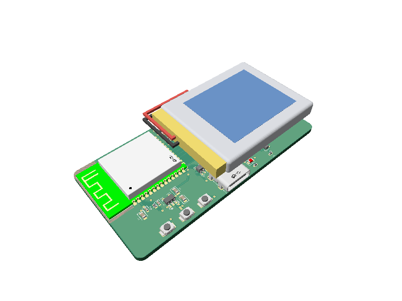
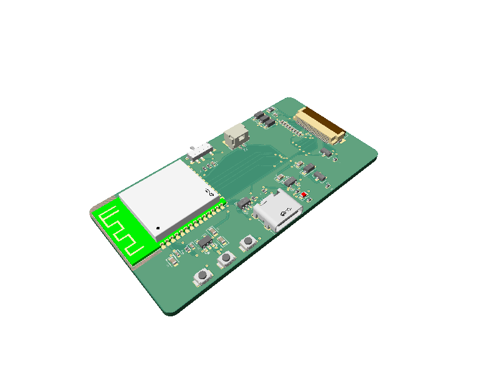
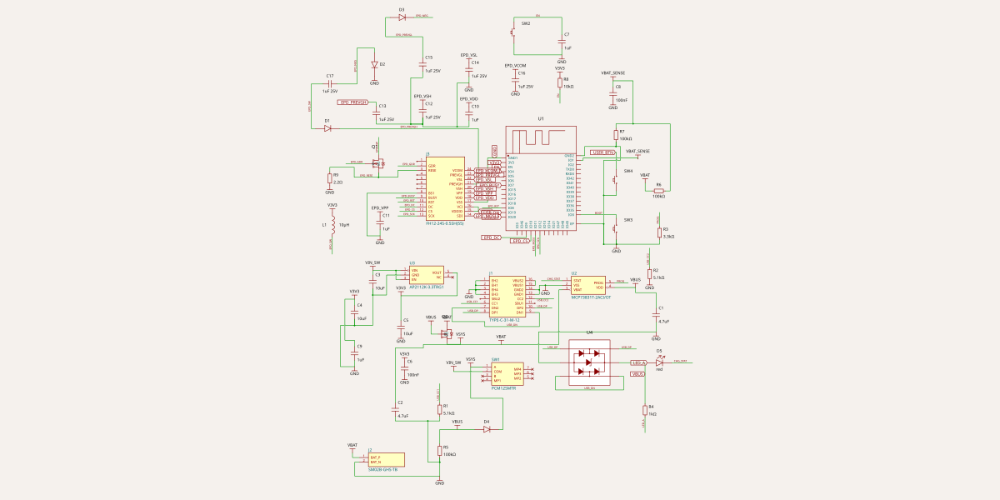

# TuneWear

A wearable clip with an ESP32-S3, a 2.13" e-paper display and USB-C LiPo charging, built on a custom 68 × 34 mm two-layer PCB. The PCB is designed as code with [tscircuit](https://tscircuit.com).



| PCB | Layout |
|---|---|
|  |  |

**Schematic** ([PDF](docs/schematic.pdf)):



## Repository layout

| Folder | Contents |
|---|---|
| [`hardware/`](hardware) | The PCB as tscircuit code: circuit, imported parts, 3D assembly preview. See [hardware/README.md](hardware/README.md) for commands, block diagram and verification status. |
| [`firmware/`](firmware) | ESP32-S3 firmware (coming soon), plus the board's pin map |
| [`docs/`](docs) | Schematic ([SVG](docs/schematic.svg), [PDF](docs/schematic.pdf)) and the renders used in this README |

## Hardware at a glance

- **MCU:** ESP32-S3-WROOM-1-N8 (Wi-Fi + BLE, native USB)
- **Display:** Waveshare 2.13" black/white e-paper (SSD1680, 250×122) on a 24-pin FPC. The board includes the panel's driver/boost circuit.
- **Power:**
  - USB-C input with ESD protection
  - MCP73831 LiPo charger (~300 mA)
  - Load sharing, so the board runs from USB while charging
  - Slide power switch and 3.3 V LDO
  - Battery voltage sense
- **Battery:** 503040 LiPo (~600 mAh) on a JST-GH 2-pin connector
- **Buttons:** RESET, BOOT, USER

## Build the PCB files

```sh
npm install -g @tscircuit/cli
cd hardware && bun install
tscircuit-cli dev                    # live PCB / schematic / 3D viewer at http://localhost:3020
tscircuit-cli export index.circuit.tsx -f gerbers -o exports/TuneWear-gerbers.zip   # Gerbers + BOM + pick-and-place
```
