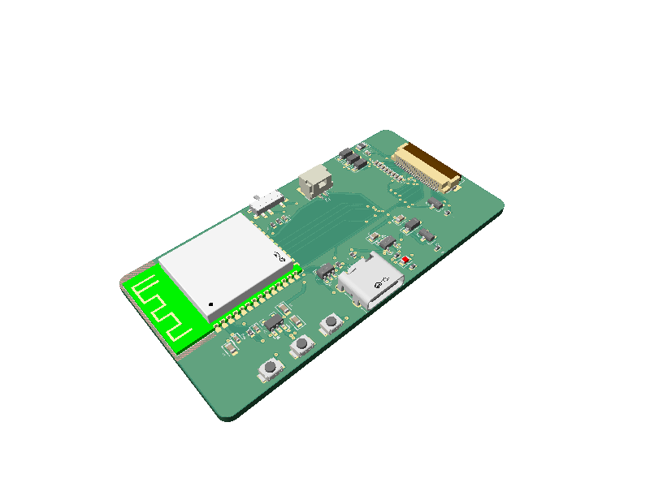

# TuneWear hardware (tscircuit)

ESP32-S3 wearable: 2.13" SSD1680 e-paper, USB-C LiPo charging, 68 × 34 mm, 2 layers.


## Files

| Path | What it is |
|---|---|
| `index.circuit.tsx` | The board: parts, nets, placement, routing rules. Fab exports come from this file. |
| `assembly.circuit.tsx` | 3D preview of the board with the display and battery (not sent to fab) |
| `imports/` | Parts imported from JLCPCB with `tscircuit-cli import` (footprints, pins, 3D models) |
| `models/` | KiCad 3D models for J2 and J3, copied from the KiCad library (CC-BY-SA 4.0 with KiCad's library exception) |
| `__snapshots__/` | Reference PCB, schematic and 3D renders from `tscircuit-cli snapshot` |

`exports/`, `dist/` and `checks/` are generated and gitignored.

## Setup

```sh
npm install -g @tscircuit/cli   # installs the CLI as `tscircuit-cli`
cd hardware && bun install      # or: npm install
```

## Commands

The CLI installs as `tscircuit-cli`, not `tsci`.

| Task | Command |
|---|---|
| Live viewer (PCB / schematic / 3D, hot reload) | `tscircuit-cli dev`, then open http://localhost:3020 |
| Build + autoroute | `tscircuit-cli build --pcb-png` |
| Checks | `tscircuit-cli check` · `check netlist` · `check placement` · `check shorts` |
| Open in KiCad | `tscircuit-cli export index.circuit.tsx -f kicad_zip -o exports/TuneWear-kicad.zip` |
| Fab files (Gerbers, drill, BOM, pick-and-place) | `tscircuit-cli export index.circuit.tsx -f gerbers -o exports/TuneWear-gerbers.zip` |

The KiCad export is one-way. Edits made in KiCad don't flow back into the code.

## Blocks

| Block | Parts |
|---|---|
| MCU | U1 ESP32-S3-WROOM-1-N8; antenna on the left edge with a copper keepout under it |
| USB | J1 HRO TYPE-C-31-M-12 (face flush with the bottom edge), U4 USBLC6 ESD protection, R1/R2 5.1k CC resistors |
| Charger | U2 MCP73831 (R3 3.3k ≈ 300 mA), D5 charge LED, J2 JST-GH 2-pin battery connector |
| Power path | D4 Schottky + Q2 P-FET load sharing → SW1 PCM12 slide switch → U3 AP2112K 3.3 V LDO |
| Battery sense | R6/R7 100k divider + C8 → GPIO1 |
| Buttons | SW2 RESET (EN), SW3 BOOT (IO0), SW4 USER (IO4), all B3U-1000P |
| E-paper | J3 Hirose FH12-24S, gate-drive boost (L1, Q1, D1–D3, R9), C9–C17 |

EPD SPI pins: SCK IO12, MOSI IO11, CS IO10, DC IO9, RST IO8, BUSY IO7. USB: D− IO19, D+ IO20.

## Assembly: display + battery

`assembly.circuit.tsx` renders the PCB together with the parts that aren't soldered to it. The viewer opens it by default, because `previewComponentPath` is set in `tscircuit.config.json`. Give it about 30 seconds to load all the 3D models. The KiCad 3D models for J2 and J3 are bundled in `models/`, since the online model cache returns 404 for them. These are 3D models only; fab exports always come from `index.circuit.tsx`. Open it in the viewer at http://localhost:3020/#file=assembly.circuit.tsx.

Stack, from front to back:

| Layer | Detail |
|---|---|
| Display (front) | Waveshare 2.13" e-Paper raw panel (250×122, black/white, 59.2 × 29.2 × 1.05 mm). Take the bare panel off the HAT; the HAT's driver board isn't used because this PCB has its own driver circuit. The panel is glued to the bare underside of the PCB, clear of the antenna, and its 24-pin FPC wraps around the right edge into J3. |
| PCB | 1.6 mm thick. Components are on the back side. |
| Battery (back) | 503040 LiPo, 5 × 30 × 40 mm, 3.7 V, ~600 mAh. It sits on foam about 4.5 mm above the board, over J2, J3 and the USB-C. It is 20 mm from the antenna and leaves SW2–SW4 uncovered. |
| Total thickness | ≈ 12.3 mm |

Before you order:
- **Battery connector:** the battery needs a **JST-GH 1.25 mm** 2-pin plug with **+ on pin 1**. Listings that say "JST 1.25" are often Molex PicoBlade, which won't fit. Many hobby LiPos also come wired with reversed polarity. Check the wire order against J2 before plugging in.
- **FPC orientation:** check the panel's FPC contact side and pin-1 orientation against the FH12-24S after the FPC wraps around the edge. It is not verified yet.
- **Buttons:** RESET, BOOT and USER all end up on the back of the device. A side-pressed switch would make USER reachable while the device is worn.

## Verification status

- **Netlist:** matches the original KiCad schematic net-for-net (34/34 nets).
- **tscircuit checks:** 0 errors. Placement DRC is clean, nothing is unrouted, and the shorts check passes.
- **Power rails:** VBUS, VSYS, VBAT, VIN_SW and V3V3 are routed at 0.4 mm. Vias are 0.6/0.3 mm.
- **KiCad DRC on the export:**
  - 0 unconnected items and 0 shorts.
  - 14 via-to-via spacings between 0.10 and 0.144 mm, which is within JLCPCB's 0.1 mm minimum but tight.
  - The rest is cosmetic: silkscreen, library links, and the pour split into fragments.

## Deviations from the KiCad design (`../archive/kicad`)

- **D1–D3:** B5819W replaces MBR0530, which isn't stocked at JLCPCB. Both are SOD-123 Schottkys.
- **ESP32 footprint:** the 12 unnetted thermal vias in the EasyEDA footprint were removed. They were below fab minimums, and the ground pad still reaches GND through the pour.
- **J1 courtyard:** trimmed to the receptacle body so the connector can sit flush with the board edge.
